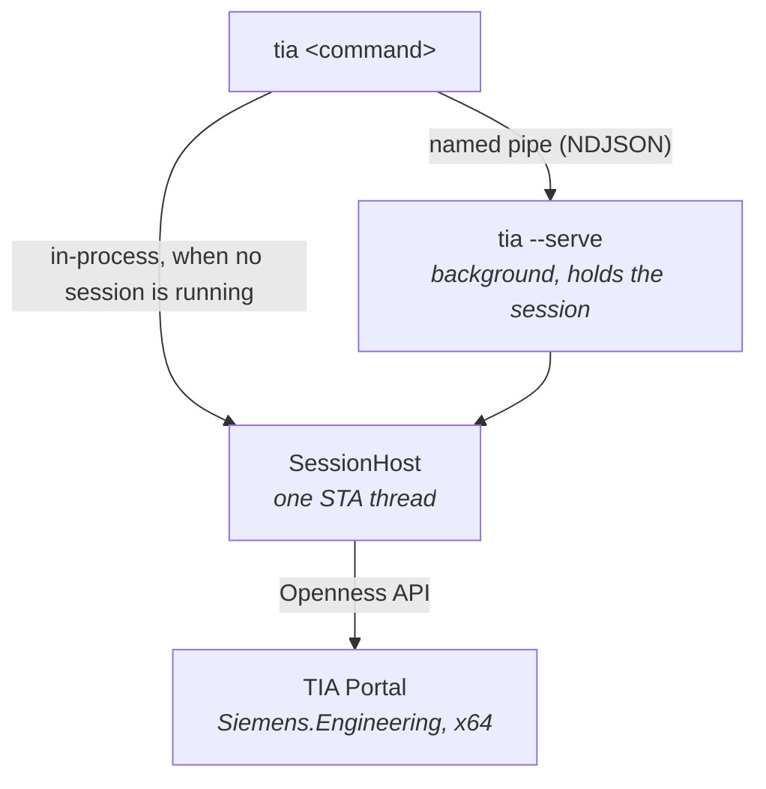

# tia-cli

A command-line tool that drives **Siemens TIA Portal** through the Openness API — list devices,
read and export program blocks, create tags, import SCL, compile — from a terminal or a script.

The point of it is the session handling. A CLI process lives for a second; an Openness connection
does not survive it, and opening a project takes minutes. So `tia` works two ways at once:

- **It joins the TIA Portal you already have open.** No setup, no flags — `tia devices` attaches to
  the running instance, answers, and detaches.
- **It can start and keep one of its own.** `tia session start` launches a portal and holds it in a
  background process, so the next fifty commands reuse it — and reuse the project you opened.

```bash
tia devices                                   # uses the portal already on your screen
tia session start --project C:\p\Line.ap20    # or start one and keep it warm
tia blocks PLC_1 --tree
tia compile PLC_1 && tia project save
```

## How it is put together



One executable plays both parts. `tia <command>` checks for a running session first and, finding
one, becomes a pipe client that never loads Openness at all; finding none, it does the work itself.
Commands are written against an `IExecutor` and cannot tell the difference.

| Piece | Job |
| ----- | --- |
| `Cli/` | Parsing, verbs, table and `--json` rendering, the interactive shell |
| `Daemon/` | Named-pipe server and client, state file, log |
| `Openness/` | Assembly resolution, the STA thread, session acquisition, all Openness calls |
| `Protocol/` | Request/response shapes, DTOs, error codes, exit-code mapping |

### How a command finds TIA Portal

In order:

1. the portal named by `--attach <pid>` or `TIA_PORTAL=<pid>` — through the session holding it, or
   attached for this one command when no session does;
2. inside a workspace, the session or portal that has the workspace's project open — or nothing,
   rather than another project (see below);
3. the session started by `tia session start`, if exactly one is running;
4. the single TIA Portal already running on this machine;
5. nothing — the command stops and says so, unless `--start` was given.

### Workspaces

A workspace is a folder that holds one TIA project, marked by a `.tia` folder at its root. `tia`
finds it by walking up from the current folder, the way git finds `.git`:

```
Line3/
  .tia/
    config     committed: the project's name, TIA version and default station
    .gitignore keeps the rest of .tia/ out of git
    project/   the working project
    archive/   Line3.zap20, for blob storage
  source/      committed: the program as files
```

```bash
tia init --from C:\projects\Line3.zap20 --station PLC_1   # make one here, with a copy of an archive or project
tia open                                  # start TIA Portal with the project, then exit
tia workspace                             # where everything is, and who has it open
tia blocks                                # from anywhere inside: this project, station PLC_1
tia export                                # the program into source/PLC_1/
tia sync                                  # what git says changed, back into TIA, then compile
```

`source/PLC_1/` mirrors TIA's tree: `Program blocks/` (SCL, STL and DB blocks as text, LAD, FBD
and GRAPH as XML), `PLC data types/` (one `.udt` each) and `PLC tags/` (one `.csv` per tag table,
with the columns of TIA's own Excel export). [GIT-WORKFLOW.md](GIT-WORKFLOW.md) is the whole loop.

No session is needed. `tia open` starts TIA Portal the way a double-click does, so it belongs to you
and closing it is closing the window; every later command finds it by its project and attaches for
as long as it runs - about a tenth of a second more than going through a session. It opens
`.tia/project`, or retrieves `.tia/archive` into it when there is no project yet. `tia open
--headless` keeps a session instead, since a headless TIA Portal closes with whatever started it,
and a session already running with no project open - `tia session start --headless`, say - is
used rather than starting another.

Inside a workspace a command goes to whichever session or portal has *its* project open, matched
by the project file's path, so a restarted TIA Portal is found again and a second project open in
another portal is never touched. When nothing has it open, commands stop with exit 3 instead of
changing some other project, and an `--attach <pid>` or `TIA_PORTAL` naming a portal that does not
have it is refused too. `--no-workspace` ignores the workspace for one command. With `station:` in
`.tia/config`, commands that take a `<station>` may leave it out.

`tia` refuses to guess rather than pick one: two portals and no session, or two sessions and no
portal named, both stop with exit 6 and list what is there.

### Several portals at once

There is one session per TIA Portal, so two projects in two portals can each have a session of
their own:

```bash
tia session start --attach 21020          # the portal you have open
tia session start --new --headless        # and one of tia's own beside it
tia session list                          # both, with their portal pids
export TIA_PORTAL=21020                   # point this shell at one of them
tia project info                          # goes to 21020's session
tia devices --attach 30364                # or name the portal per command
tia session stop --attach 30364           # stop one; --all stops every one
```

With a session already running, `session start` needs `--attach <pid>` or `--new` to start
another, so two sessions never share a portal.

Whether a portal closes when you are done follows from who started it. One that `tia` started is
owned by `tia` and closes with the session; one that was already running is left alone. `tia session
status` says which it is holding, in those words, before you stop it.

## Requirements

- Windows x64, TIA Portal installed **with the Openness option**.
- Your Windows account in the local **Siemens TIA Openness** group. Add it, then sign out and back
  in — membership is read at logon. Without it every call fails with `access_denied`.
- .NET 8 SDK to build. .NET Framework 4.8, which the tool targets, is part of Windows.
- A licensed TIA Portal product — normally **STEP 7 Professional** — for anything that *changes*
  hardware. Openness itself needs no licence, so connecting, opening projects, listing devices,
  blocks and tags all work without one; `device add`, `device ip` and the rest of the hardware
  surface fail with `licence_missing` (exit 8). The licence is checked when the call runs, not when
  you connect, so a machine can look entirely healthy until the first write.

`Siemens.Engineering.dll` references `System.Runtime.Remoting`, which exists only in .NET Framework —
so the tool targets net48 even though it is built with the .NET 8 SDK.

## Install

Unpack `tia-cli-<version>-win-x64.zip` and run, from the folder it made:

```bash
powershell -ExecutionPolicy Bypass -File install.ps1
```

It checks the machine over first — .NET Framework 4.8, an Openness installation, your membership of
the **Siemens TIA Openness** group — and says which of them is missing rather than leaving you to
find out one failed command at a time. It also clears the two things that stop a downloaded copy
from working at all: the mark of the web the zip carries, and any forced-elevation flag on
`tia.exe`. Both make the daemon's launch fail as "the operation was canceled by the user" about
something nobody was asked; see [Why the daemon might not start](#why-the-daemon-might-not-start). Then it copies the tool to `%LOCALAPPDATA%\Programs\tia-cli`
and puts that on your user PATH. Open a new terminal afterwards, since the one you ran it from still
has the old PATH.

Last, it does the machine-wide part that decides whether `tia` can reach TIA Portal at all: it
writes the Openness whitelist entry for this exact `tia.exe`, adds you to the Siemens TIA Openness
group if you are missing from it, and clears a machine-wide forced-elevation flag. That needs an
administrator, so from a normal prompt it asks once through UAC; from an elevated prompt it just
runs. If it added you to the group, sign out and back in before using `tia`. Re-run the install
after every upgrade: the approval is tied to the exe's bytes, so a new build is unapproved until
then. `repair.ps1` does this work and stays in the install folder for later.

**Where you run it from does not matter, and neither does where it installs.** Unpack the zip
anywhere — Downloads, a USB stick, a network share — and run `install.ps1` from there; it installs
to `%LOCALAPPDATA%\Programs\tia-cli`, or to any `-InstallDir` you name, including `C:\tia` or a
folder on another drive. What matters is that the installed folder then *stays put*: the Openness
approval records the exe's full path alongside a hash of its bytes, so moving or rebuilding it
invalidates the approval. `repair.ps1` and `uninstall.ps1` are copied in beside `tia.exe` and act on
whatever folder they find themselves in, so a non-default install needs no arguments later either.

`-InstallDir <path>` puts it somewhere else, `-NoPath` leaves your PATH alone, and `-NoElevate`
skips the machine-wide step and writes nothing outside your profile. Installing over an
existing copy stops its session first — a background session owns a TIA Portal, and replacing the
exe underneath it would strand that portal with nothing left to close it.

To remove it:

```bash
powershell -ExecutionPolicy Bypass -File "%LOCALAPPDATA%\Programs\tia-cli\uninstall.ps1"
```

Which stops the session, takes the folder off your PATH, and deletes both the tool and its state
file and log. `-KeepData` keeps the latter two. The Openness whitelist entry under HKLM is left
alone, being harmless once the exe it names is gone; `-RemoveWhitelist` clears it, asking for
administrator rights as it goes.

For a machine that has collected copies over time — an install here, an unpacked zip there, a build
folder that was once approved — `-All` finds every one of them, from your PATH, the machine PATH,
the Openness whitelist, any running `tia.exe` and the default location, and clears the lot including
the registry. It says what it found and what will happen to each folder before touching anything,
and `-Yes` skips the asking:

```bash
powershell -ExecutionPolicy Bypass -File uninstall.ps1 -All
```

A folder is only deleted outright when everything in it came from the zip. Anywhere shared — a drive
root, your profile, a Desktop, a build tree — keeps its folder and loses only the files tia put
there, because "the install folder" can perfectly well be `C:\`.

## Build

```bash
powershell -File tools/build.ps1
```

That publishes `dist\tia.exe` to run in place while you are changing it — the inner loop, not a way
to install. It leaves PATH alone; `install.ps1` owns that, and two scripts adding two different
folders is how you end up with a `tia` answering from somewhere unexpected that outlives an
uninstall. Pass `-OpennessAssemblyPath <path>` if TIA Portal is not at the default location — only
the compile-time reference is affected, since at runtime the assembly is found through the registry
and one build drives whichever version is installed.

Unit tests cover the parts that run without Openness — argument parsing, the wire protocol, error
translation and exit codes, the daemon state file:

```bash
dotnet test src/Tia.Cli.Tests/Tia.Cli.Tests.csproj
```

To build the release zip — tests, a fresh publish, the install scripts and a `.sha256`, into
`dist\`:

```bash
powershell -File tools/package.ps1
```

It always publishes fresh rather than packaging whatever is sitting in `dist\`, and refuses to
package at all if the tests fail. The version comes from `Version` in `Directory.Build.props`, which
is the one place it is written; `tia --version` reads it back off the assembly.

The commands that need hardware — `download`, `upload`, `sim`, the `show` verbs — are verified on a
machine that has it, with `tools/fieldtest.ps1`. That is maintainer tooling and does not ship in the
release zip; [the field-test skill](.claude/skills/field-test/SKILL.md) covers running it and
reading its report.

## The first run pauses for a dialog

The first time a given `tia.exe` talks to Openness, **TIA Portal puts an "Openness access" window on
screen and blocks until you answer it**. Approve it once and the approval is recorded under
`HKLM\SOFTWARE\Siemens\Automation\Openness\<version>\Whitelist`.

The record holds the exe's path *and* a hash of its bytes, so **rebuilding or moving `tia.exe` asks
again**. That is why a command can appear to hang with nothing on the terminal: the window belongs to
TIA Portal, and a daemon started in the background gives you no hint that it is waiting for one.
`tia` checks the whitelist before it connects and warns you when this run is going to need it.

Two details worth knowing, both learned the hard way:

- **While that window is unanswered, the portal answers nothing** — not even a call from an unrelated
  program. So a command that needs no approval of its own (`tia portals` only enumerates processes)
  can still hang behind somebody else's pending dialog. If a command stalls, look for the window
  before assuming the tool is stuck.
- **Approval follows the bytes, not the name.** Killing a client does not withdraw its pending
  request, and answering it later records approval for *that* build — which tells you nothing about
  the one you are running now.

### Answer it in the foreground, first

Approve the dialog by running one command in the foreground, against a TIA Portal you have open on
screen, before you start a session:

```bash
tia devices --no-daemon
```

A session runs its portal in the background, and a headless one has no user interface at all — so
that window has nowhere to appear, nobody answers it, and the call eventually gives up as
`access_denied` (exit 7) with the misleading text "Security error. The operation has timed out."
`install.ps1` prints this instruction when the file it just installed is not yet approved. With more than one portal open `tia` cannot tell which you mean, so add `--attach <pid>` from `tia portals`, or `--start` to approve against a throwaway portal of its own.

An administrator can pre-empt the dialog instead by writing the whitelist entry directly, which is
what `install.ps1` does unless you pass `-NoElevate` or decline its UAC prompt. `repair.ps1`, left in
the install folder, does the same on its own and asks for UAC itself. TIA Portal still has the
final say.

### Why the daemon might not start

`tia session start` launches the daemon through `ShellExecute`, so that it detaches from the console
and outlives the command. Two unrelated things make that fail with `ERROR_CANCELLED` — reported as
**"the operation was canceled by the user"** when nobody was asked anything:

- **The mark of the web.** A zip downloaded with a browser is tagged with the internet zone, and
  every file unpacked from it inherits the tag. On an unsigned executable, SmartScreen refuses the
  launch. `install.ps1` clears the tag from what it installs; `Unblock-File` does it by hand. The tag
  is an alternate data stream, so removing it does not change the file's bytes — the Openness
  approval survives.
- **A forced-elevation flag.** A `RUNASADMIN` compatibility layer on `tia.exe` turns that hidden
  launch into a UAC prompt with nowhere to appear, which Windows then declines for you.
  `install.ps1` clears it for your own account, and machine-wide in its elevated step.

If it still will not start, run `tia --serve` in a visible terminal and use `tia` from a second one:
whatever the shell is refusing becomes visible instead of being swallowed. The daemon's own log is
at `%LOCALAPPDATA%\tia-cli\daemon.log`.

## Commands

Run `tia help` for the full text.

| | |
| --- | --- |
| `tia init [<folder>]` | Make a workspace: `.tia/` (`config`, `project/`, `archive/`) and `source/`. `--name <project>`, `--station <station>`, `--from <.apNN \| .zapNN>` copies one in |
| `tia open` | Start TIA Portal with the workspace's project and exit. `--headless` keeps a session instead; `--upgrade`, `--timeout <seconds>` |
| `tia workspace` | Where the workspace's files are and who has its project open |
| `tia export [<station>]` | The station's program into `source/<station>/`: `Program blocks/`, `PLC data types/` (`.udt`), `PLC tags/` (`.csv`) |
| `tia sync [<station>]` | What git says changed under `source/<station>/` back into the project, then compile. `--file <path>`, `--no-compile` |
| `tia portals` | TIA Portal instances running on this machine |
| `tia session start` | Start a background session and keep it. `--new`, `--headless`, `--attach <pid>`, `--project <path>`, `--idle <minutes>` |
| `tia session list` | Every running session and the TIA Portal it holds |
| `tia session status` | What is running, what it is attached to, what is open |
| `tia session stop` | End the session. `--attach <pid>` picks one of several, `--all` ends every one |
| `tia shell` | Interactive prompt holding one session open |
| `tia project open <path>` | Open a project (`--upgrade`) |
| `tia project new <dir> <name>` | Create one |
| `tia project info` / `save` / `close` | `close --save` to save on the way out |
| `tia project archive [<path>]` | Pack the project into one `.zapNN` file. No path: beside the project folder. `--save` first if there are unsaved changes, `--minimize` leaves out what TIA can rebuild, `--overwrite` replaces an existing archive |
| `tia project retrieve <archive> <dir>` | Unpack an archive into `<dir>` and open it (`--upgrade`) |
| `tia devices` | Stations, their CPUs and addresses |
| `tia catalog <filter>` | Search the hardware catalog for order numbers (`--limit <n>`, default 50) |
| `tia device add <type> <name>` | Add a station from a type identifier (`--device-name <n>` for the device item) |
| `tia hw export <file>` | Export the hardware configuration as CAx data (AutomationML). `--device <station>` for one station |
| `tia hw import <file>` | Import CAx data. `--existing retain\|overwrite\|park` decides what happens to a device already there (default retain) |
| `tia device ip <station>` | `--address <ip> --mask <netmask>`, `--subnet <name>` for the TIA subnet, gateway with `--router <ip>` / `--no-router` |
| `tia device attrs <station>` | List the Openness attributes of the CPU (`--filter <text>`) |
| `tia device set <station> <attribute> <value>` | Change one of them |
| `tia device protection <station>` | Access level and passwords (`--level`, `--password`, `--secret`). A current CPU will not compile until the last two are set |
| `tia blocks <station>` | List blocks (`--filter`, `--type OB,FB,FC,DB`, `--tree`, `--system`) |
| `tia block show <station> <block>` | Header, interface and network titles |
| `tia block source <station> <block>` | The block as SCL/STL/DB text (`--out <path>`, `--deps`) |
| `tia block export <station> <block>` | Openness XML (`--out <path>`, `--print`) |
| `tia blocks export [<station>]` | Every block into the program's folders (`--source` for text where there is one, `--out <dir>`, `--filter`, `--type`). Default `<station>/Program blocks/`, under `source/` in a workspace |
| `tia blocks import [<station>]` | Every `.scl`, `.awl`, `.db` and `.xml` in a folder, its folders becoming the program's (`--from <dir>`, same default). Deletes and compiles nothing |
| `tia block import <station> <file>` | Blocks from Openness XML (`--folder <path>`, `--overwrite`) |
| `tia block rename <station> <block> <new>` | Rename a block |
| `tia block delete <station> <block>` | Delete a block (`--force` skips the question) |
| `tia folder add` / `tia folder delete <station> <path>` | Folders in the block tree |
| `tia sources <station>` | List external sources |
| `tia source add <station> <name>` | SCL from `--file`, `--code`, or stdin (`--no-generate`, `--folder`) |
| `tia source generate <station> <name>` | Compile a source already in the project (`--folder`) |
| `tia source delete <station> <name>` | Delete a source; blocks it made stay |
| `tia tables <station>` | Tag tables |
| `tia tags <station>` | Tags as CSV, never JSON. `--table <t>` prints that table's own file |
| `tia table add <station> <name>` | Create a tag table |
| `tia tag add <station> <name>` | Create a tag (`--table <t>`, default the default table; `--type <dt>`, `--address <addr>`) |
| `tia table export <station> <table>` | One tag table as CSV (`--out <file>`), or with `--xml` as TIA's own XML, user constants and every comment language included |
| `tia tables export [<station>]` / `tables import` | Every tag table, out (`--out <dir>`, `--xml`) or in (`--from <dir>`, `.csv` and `.xml`). Default `<station>/PLC tags/` |
| `tia table import <station> <file.csv>` | The table holds exactly the file's tags afterwards (`--name`, `--folder`). A `.xml` replaces the table it names, constants included |
| `tia types <station>` | PLC data types (UDTs) |
| `tia type export <station> <type>` | One data type as `.udt` (`--out <file>`) |
| `tia types export [<station>]` / `types import` | Every data type, out (`--out <dir>`) or in (`--from <dir>`). Default `<station>/PLC data types/` |
| `tia type import <station> <file.udt>` | Generate the data type(s) in a `.udt` file (`--folder`) |
| `tia compile <station>` | Compile. Exits non-zero when it reports errors. |
| `tia download <station>` | Download to the PLC (`--address`, `--via`, `--interface`, `--target`, `--slot`, `--hardware`, `--changes`, `--stopped`, `--force`, `--secret`, `--plc-password`) |
| `tia upload <ip>` | Upload the station at that address into the project as a new station (`--via`, `--interface`, `--slot`) |
| `tia sim create <station>` | **In development.** Creates a PLCSIM instance and powers it on (`--cpu`, `--address`, `--mask`, `--timeout <seconds>`). S7-1500 and up only, and TIA will not download to the instance it makes — see below |
| `tia sim start <station>` | **In development, and does not currently work as expected.** Meant to be the download to S7-PLCSIM (`--advanced` for PLCSIM Advanced; `--address`, `--interface`, `--slot`, `--hardware`, `--stopped`, `--target`, `--secret`, `--plc-password` as for `download`). Start the simulation from TIA and use `tia download <station> --interface PLCSIM` instead |
| `tia show hw` | Open the hardware editor (`--view device\|network\|topology`) |
| `tia show device <station>` | Open one station in it (`--view ...`) |
| `tia show block <station> <block>` | Open a block's editor |
| `tia show table <station> <table>` | Open a tag table |

Global: `--json` (not for `tags`, which is CSV), `--attach <pid>` (or `TIA_PORTAL=<pid>`),
`--no-workspace`, `--start`, `--headless`, `--new`, `--no-daemon`, `--openness-version <v>`,
`--quiet`, `--version`, `-h` / `--help`. `--timeout` is in seconds wherever it appears.

### Several ways to the same thing

Some jobs have more than one command, the way git has `checkout -b` beside `branch` and `checkout`.
The longer road does a part on its own; the shorter one does the whole job.

| Job | Commands |
| --- | --- |
| The whole program out | `tia export` = `blocks export --source` + `types export` + `tables export`. Only `export` also deletes the files of what is gone from the project |
| The whole program in | `tia sync` (what git says changed, deletions too, then a compile) · `blocks import` + `types import` + `tables import` (everything in the folders, nothing deleted, no compile) |
| One or all | Singular for one - `block export Motor` - plural for all - `blocks export`. The older `--all` (`block export --all`, `block source --all`, ...) still works |
| Text into the project | `source add` (keeps the external source) · `sync --file` (removes it) · `type import` (`.udt`) |
| An XML block in | `block import` · `sync --file <file.xml>` |
| A tag table in | `table import` · `sync --file <file.csv>` (or `.xml`) |
| One tag table out | `tags --table <t> > t.csv` = `table export <t>` |
| One tag | `tag add` · a row in the table's CSV, then `table import` or `sync` |
| Delete a block | `block delete` · delete its file, then `sync` |
| Open a project | `project open` · `open` in a workspace · `session start --project` · `project retrieve` from an archive |
| Pick a portal | `--attach` · `TIA_PORTAL` · the workspace |

`scl import` is an old name for `source add`, kept working and left out of the help.

### Scripting

`--json` prints the raw result of any command but `tags`, and exit codes are specific:

```
0 ok   1 failed   2 bad arguments   3 no session   4 no project   5 not found
6 ambiguous   7 access denied   8 licence missing   9 portal unusable
```

```bash
tia devices --json | jq -r '.[].name'
type block.scl | tia source add PLC_1 Motor
tia compile PLC_1 || echo "compile failed"
```

## Things that are not obvious

- **Everything runs on one STA thread.** The Openness object model is not thread-safe and hands back
  objects bound to the thread that made them; calling from a pool thread produces intermittent
  `RemotingException`s rather than a clean error. One thread also serialises requests, which is right
  anyway — TIA cannot service two at once.
- **`Siemens.Engineering.dll` is a compile-time reference only.** At runtime it is located through
  `HKLM\SOFTWARE\Siemens\Automation\Openness` and handed to the CLR by an `AssemblyResolve` handler.
- **No method that touches Openness may be entered before that handler is installed.** The JIT
  resolves a method's types when the method starts, not line by line, so the executor is built
  through a deliberate two-step with a `[MethodImpl(NoInlining)]` core. `Program.cs` references
  nothing Openness-backed.
- **Disposing a `TiaPortalProcess` closes that TIA Portal, and so does its finaliser.** That holds
  for every handle — the ones `TiaPortal.GetProcesses()` returns as much as the one
  `portal.GetCurrentProcess()` returns — and for a portal somebody else opened: up to 0.3.0,
  `tia portals` disposed what it listed and closed every portal on the machine, window, project and
  unsaved work. Leaving a handle to become garbage is no better: the finaliser does the same at the
  next collection, or at process exit, nowhere near the code that fetched it. So handles are held
  for as long as their portal is in use and then let go with `GC.SuppressFinalize`, never disposed.
- **The daemon answers `ping`, `status` and `stop` on the connection thread**, not through the
  Openness queue. So `tia session status` still replies while a project is opening, which is exactly
  when you want to ask.
- **A project opened in the UI after `tia` attached is picked up anyway.** Rather than fail with "no
  project open", the session re-probes the portal's project list first — attaching to someone's live
  portal is the main use case, and their project appearing mid-session is normal.
- **`tia project new` writes nothing to disk until `tia project save`**, and blocks made by
  `source add` are not checked until `tia compile`.
- **An archive is made from what is on disk.** TIA refuses to archive a project with unsaved
  changes, so `tia project archive` says so up front and takes `--save`. With `--overwrite` the old
  archive is moved aside and only dropped once the new one exists — a failed run does not cost the
  last backup. `tia project open` on a `.zapNN` file points at `tia project retrieve` instead of
  passing on the bare Openness error.
- **A block's interface is not readable through Openness.** Only `DataBlock` has an `Interface`
  property at all, and its members give up nothing but their names — no data type, no start value, no
  comment. So `tia block show` exports the block to a temporary file and reads the SimaticML back.
  That is why it takes a moment where `tia blocks` is instant, and why it matches elements by local
  name: the SimaticML namespaces carry a schema version that moves with every TIA release.
- **SCL is the only way text becomes a block.** `CreateFB` makes an empty block with no way to set a
  body, and XML import demands the full schema — so `tia source add` writes the text to a file,
  registers it as an external source and asks TIA to compile it. `tia block source` is the same road
  in reverse, which makes the pair a round trip.
- **A download is a dialog, even without a screen.** Openness turns TIA's download dialog into a
  series of callbacks, and an unanswered one aborts the transfer. `tia download` answers the routine
  prompts the way the dialog's defaults would and records each answer in its output; the destructive
  ones — reset module, reinitialize data blocks, firmware up/downgrade, protection-level changes —
  abort with the prompt's name unless `--force` was given. Password prompts are refused unless the
  password was given for that run: `--secret` answers the master-secret prompt, which a current CPU
  requires before it will compile at all, and `--plc-password` answers the access-level ones. Neither
  is remembered anywhere, and without them the prompt aborts by name as before — a CLI has no
  business holding PLC passwords of its own accord. An unrecognised prompt aborts by name so it can be
  added deliberately rather than answered by accident.
- **There is no "start simulation" call in Openness.** What exists is downloading to a simulator, and
  `tia sim start` is that download. Up to V17 it goes to the `PLCSIM` connection mode, which also
  boots the simulator. From V18 that mode is gone: a simulated PLC is an ordinary PN/IE target behind
  the *Siemens PLCSIM Virtual Ethernet Adapter*, at its own IP address, so `sim start` uses that adapter
  instead — and the PLCSIM instance must already be running at the device's IP, because TIA will not
  start one for a download. PLCSIM Advanced instances take `--advanced` for the software-target prompt. `tia sim create` is meant to remove that manual step and is **still in development**: PLCSIM exposes a Runtime API that builds instances, but only *Advanced* ones, which this TIA refuses as a download target and which need the PLCSIM Advanced licence. What works today is starting the simulation in TIA and running `tia download <station> --interface PLCSIM`.
- **Never throw from inside a download callback.** TIA treats an exception in its own callback as
  fatal: it surfaces as a `NonRecoverableException`, the portal is gone, and whatever the exception
  said is lost. Prompts `tia` will not answer are declined inside the callback and reported by name
  once the download returns.
- **A running session only knows the wire methods of the binary it was started from.** After a
  rebuild that adds commands, `tia session stop` and start again — otherwise the old daemon answers
  new verbs with "Unknown method".
- **A project opened through Openness stays in the portal view until an editor is asked for.** That
  is what the `show` verbs are: `ShowHwEditor(View)` on the project, `ShowInEditor()` on a block or
  tag table — the one corner of Openness that drives the UI rather than the data. They need a portal
  started `WithUserInterface`, so a headless session refuses them with an explanation rather than an
  obscure Openness failure.
